<!-- ============ Header (Pink & Typing) ============ -->

  
   
  
   
  

 

<!-- ============ Bloom Header (live weather · day / night follows your theme) ============ -->

  <picture>
    <source media="(prefers-color-scheme: dark)" srcset="bloom-header-night.svg" />
    
  </picture>

 

<!-- ============ Tech Garden (Your Pink Skills) ============ -->

     
 
     
 
   

🌱 &nbsp;<b>Field guide</b> — open to read what every chip actually is

 

 
 
 

 

<!-- ============ Projects (极简缩小字体版) ============ -->

  
  <!-- 项目一：Hometree 社交 App -->
  
   
  <i>Architecting an intimate, privacy-first social space where connections are driven by shared tastes in music, cinema, and literature.</i>
  
     

  <!-- 项目二：Rhythm Runner 音游官方网站 -->
  
   
  <i>Bridging computer music theory and gameplay. An automated beatmap generation engine that translates raw audio waveforms into real-time rhythmic challenges.</i>

 

<!-- ============ Stats (Live from your account) ============ -->

  <picture>
    <source media="(prefers-color-scheme: dark)" srcset="https://github-readme-streak-stats.herokuapp.com/?user=myrazanglin-art&hide_border=true&background=00000000&ring=FF69B4&fire=FF69B4&currStreakLabel=FF69B4&sideLabels=FF69B4&dates=FFB6C1&currStreakNum=FF69B4&sideNums=FF69B4&stroke=FF69B4" />
    
  </picture>

 

<!-- ============ Snake ============ -->

  

<!-- ============ Footer (a cat lives here) ============ -->

  <picture>
    <source media="(prefers-color-scheme: dark)" srcset="garden-footer-night.svg" />
    
  </picture>

   

  <!-- Profile views -->
  

  Un jour je serai de retour près de toi.

